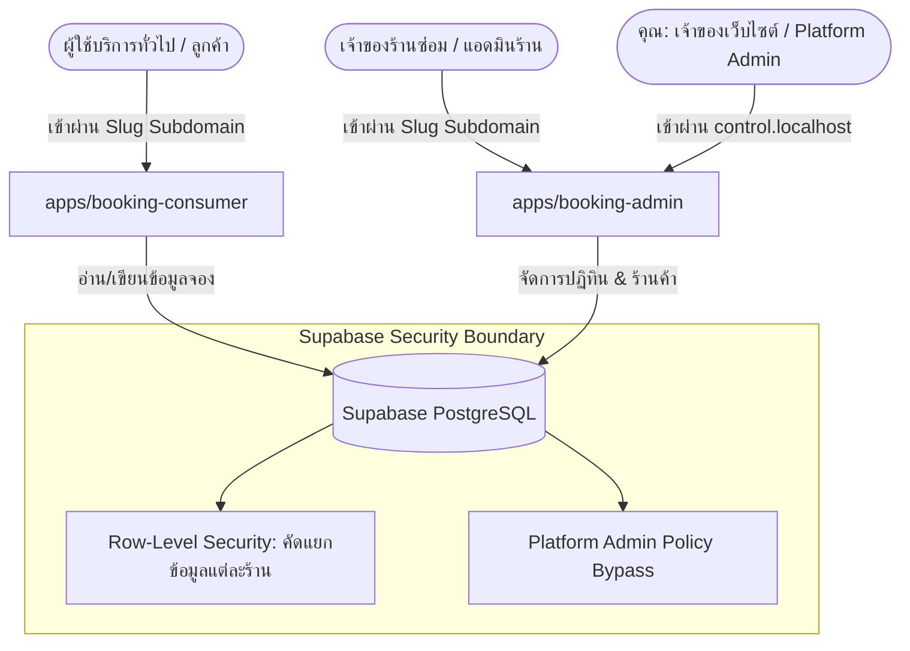

# 📘 คู่มือผู้ดูแลแพลตฟอร์ม (Platform Owner's Manual)
### ระบบจองคิวซ่อมรถจักรยานยนต์แบบ Multi-Tenant (Bike Booking SaaS)
---

คู่มือฉบับนี้จัดทำขึ้นสำหรับ **คุณในฐานะเจ้าของเว็บไซต์ (Platform Owner)** เพื่อเป็นแนวทางในการควบคุม บริหารจัดการ และบำรุงรักษาระบบจองคิวรถจักรยานยนต์หลากร้านค้า (SaaS) ภายใต้แนวคิด **"งบประมาณ 0 บาท" (Zero-Budget Architecture)** โดยใช้ทรัพยากรระดับฟรี (Free Tier) ของ Supabase และ Vercel ได้อย่างมีประสิทธิภาพและปลอดภัยสูงสุด

---

## 🏗️ 1. สถาปัตยกรรมระบบ (System Architecture)

ระบบถูกออกแบบมาเป็น **Monorepo** แบ่งแอปพลิเคชันออกเป็น 2 ส่วนหลักที่ทำงานประสานกันบนระบบฐานข้อมูลเดี่ยวแบบคลาวด์ (Supabase DB) และคัดแยกผู้ใช้งานตามชื่อซับโดเมน (Subdomain-based Multi-tenancy) อย่างสมบูรณ์:



### 💻 2. เทคโนโลยีและบริการฟรี (Zero-Budget Stack)
*   **Frontend & Admin App:** Next.js (App Router) พัฒนาด้วย TypeScript และ Vanilla CSS/Tailwind
*   **Database & Auth & Realtime:** Supabase Free Tier (มีขีดจำกัดหน่วยความจำและจำนวนคำขอ ซึ่งสามารถบริหารจัดการได้ฟรีตลอดไป)
*   **Hosting:** Vercel Hobby Plan (ฟรีสำหรับโปรเจกต์ส่วนตัวและช่วยสเกลระบบได้ฟรี)

---

## 🛠️ 2. วิธีการรันระบบและทดสอบในเครื่องตัวเอง (Local Development & Testing)

ในการพัฒนาหรือทดสอบระบบบนเครื่องของคุณเอง (Mac/PC) ระบบได้เขียน Middleware เพื่อตรวจจับชื่อโฮสต์โดยอัตโนมัติ ทำให้คุณสามารถจำลองการเข้าใช้งานของแต่ละร้านค้าผ่านคอมพิวเตอร์ของคุณได้โดยตรง

### 1. การแมปซับโดเมนในเครื่องคอมพิวเตอร์ (Local Hostname Mapping)
โดยทั่วไป พอร์ตบริการในเครื่องคือ `localhost:3000` เพื่อทดสอบระบบ Multi-tenant คุณต้องแก้ไขไฟล์ระบบ `hosts` ในเครื่องเพื่อจำลองซับโดเมน:

1.  เปิด Terminal บน Mac ของคุณ
2.  รันคำสั่งแก้ไขไฟล์ (ต้องใช้รหัสผ่านเครื่อง):
    ```bash
    sudo nano /etc/hosts
    ```
3.  เพิ่มบรรทัดเหล่านี้ลงไปที่ส่วนท้ายสุดของไฟล์:
    ```text
    127.0.0.1   control.localhost
    127.0.0.1   kmorackbarcustom.localhost
    127.0.0.1   testshop.localhost
    ```
4.  กด `Ctrl + O` เพื่อบันทึก และ `Ctrl + X` เพื่อออก

> [!TIP]
> ตอนนี้คุณสามารถพิมพ์เข้าเว็บในเบราว์เซอร์ด้วย url:
> *   ระบบจัดการของ Platform Admin: `http://control.localhost:3000/platform`
> *   หน้าจองสำหรับลูกค้า (ร้าน K-Morack): `http://kmorackbarcustom.localhost:3000`
> *   หน้าจัดการหลังบ้าน (ร้าน K-Morack): `http://kmorackbarcustom.localhost:3000/dashboard`

### 2. การสั่งรันเซิร์ฟเวอร์จำลองในเครื่อง
1.  ติดตั้ง Dependencies ทั้งหมด (รันที่โฟลเดอร์หลัก):
    ```bash
    npm install
    ```
2.  เริ่มรันแอปพลิเคชันสำหรับพัฒนา:
    *   **รันฝั่งหลังบ้านแอดมิน (booking-admin):**
        ```bash
        npm run dev --workspace=apps/booking-admin
        ```
    *   **รันฝั่งลูกค้าสำหรับจอง (booking-consumer):**
        ```bash
        npm run dev --workspace=apps/booking-consumer
        ```

---

## 🔑 3. ระบบควบคุมส่วนกลาง (Platform Owner Admin Dashboard)

คุณมีหน้าจอสำหรับควบคุมระบบทั้งหมดแบบ **Control Center** อยู่ที่ซับโดเมนกลาง ซึ่งใช้สำหรับตรวจตราทุกร้านค้าในระบบ ปรับปรุงสถานะการจองข้ามร้าน และลงทะเบียนร้านค้าใหม่ในคลิกเดียว

> [!IMPORTANT]
> **ที่อยู่หน้าควบคุมกลาง (Platform Dashboard URL):**
> *   **Local:** `http://control.localhost:3000/platform`
> *   **Production:** `https://control.craftbikelab.com/platform`

### 🛡️ สิทธิ์การเข้าใช้งานพิเศษ (Security Guardrails)
ระบบหลังบ้านใช้ฟังก์ชันฐานข้อมูล `bike_booking.is_platform_admin()` เพื่อตรวจสอบสิทธิ์ของคุณจากตารางบัญชีผู้ใช้ หากบัญชีของคุณมีสิทธิ์เป็น Platform Admin ระบบ RLS (Row-Level Security) จะอนุญาตให้คุณอ่านข้อมูลทุกร้านค้าและทำการแก้ไขได้ทันทีโดยไม่ถูกบล็อกข้อมูลเหมือนผู้ใช้ทั่วไป

---

## 🚀 4. คู่มือการเพิ่มร้านค้าใหม่ใน 1 คลิก (One-Click Tenant Onboarding)

คุณสามารถเพิ่มร้านค้าซ่อมรถจักรยานยนต์ร้านใหม่เข้าสู่แพลตฟอร์มของคุณได้โดยง่าย ผ่านหน้าจอ **Platform Admin Console** ที่สร้างไว้ให้เรียบร้อยแล้ว ดังนี้:

### 📸 ขั้นตอนการลงทะเบียนใช้งานจริง:

```
[ คลิกปุ่ม "+ เพิ่มร้านค้าใหม่" ]
        │
        ▼
[ กรอกข้อมูลในฟอร์มย่อย ]
 ├── Slug (ชื่อย่อโดเมนภาษาอังกฤษ) --> เช่น: kmorackbarcustom
 ├── ชื่อร้านค้า --> เช่น: K-Morack Bar Custom
 ├── เบอร์โทรศัพท์ --> เช่น: 081-xxxxxxx
 └── รหัสผู้ดูแลร้าน (UUID) --> นำมาจากหน้า Supabase Auth
        │
        ▼
[ กดปุ่ม "สร้างร้านค้าทันที" ]
        │
        ▼
[ ระบบ Provisioning อัตโนมัติในฐานข้อมูลแบบ Transaction (Atomic) ]
 ├── 1. ตรวจสอบสิทธิ์ Platform Admin
 ├── 2. สร้างร้านค้าใหม่ในตาราง shops
 ├── 3. เพิ่มค่าบริการเริ่มต้นให้ฟรีทันที 3 รายการ
 └── 4. ผูกบัญชีเจ้าของร้าน (Owner) และมอบสิทธิ์คุมร้านนั้น
```

### 📋 รายละเอียดการกรอกข้อมูลในฟอร์ม:
| ชื่อฟิลด์ | ตัวอย่างข้อมูล | คำอธิบายและข้อจำกัด |
| :--- | :--- | :--- |
| **ชื่อย่อโดเมนภาษาอังกฤษ (Slug)** | `k-custom` | ใช้เป็นชื่อซับโดเมนและระบุตัวตนใน URL **(ห้ามใช้ภาษาไทย/เว้นวรรค/ตัวพิมพ์ใหญ่)** |
| **ชื่อร้านค้า (Shop Name)** | `เค-คัสตอม การาจ` | ชื่อร้านที่ลูกค้าจะเห็นหน้าเว็บและในใบจอง |
| **เบอร์โทรศัพท์ติดต่อ (Phone)** | `089-999-9999` | เบอร์ติดต่อหลักของร้านค้านั้น |
| **รหัสผู้ดูแลร้าน (Owner User UUID)** | `f81d4fae-7dec-11d0-a765-00a0c91e6bf6` | รหัส UUID ของผู้ใช้งานที่สมัครสมาชิกเข้ามา นำมาจากระบบหลังบ้าน Supabase Auth |

> [!NOTE]
> **ระบบโพรวิชันนิ่งอัตโนมัติ (Automated Provisioning):**
> ทันทีที่คุณกดปุ่มยืนยัน ระบบ Supabase Stored Procedure จะแนบงานบริการเริ่มต้นของร้านซ่อมรถให้อัตโนมัติ ได้แก่:
> 1.  **ตรวจเช็ครถ** (ระยะเวลา 1 ชั่วโมง)
> 2.  **เปลี่ยนน้ำมันเครื่อง** (ระยะเวลา 1 ชั่วโมง)
> 3.  **ติดตั้งของแต่ง** (ระยะเวลา 3 ชั่วโมง)
> ทำให้เจ้าของร้านค้าใหม่ล็อกอินเข้ามาแล้วเริ่มใช้งานรับงานจองได้ทันทีโดยไม่ต้องไปตั้งค่าเริ่มต้นเองให้ยุ่งยาก!

---

## 💾 5. แผนการจำกัดงบประมาณ 0 บาท (0-Baht Operations & Hardening Plan)

เนื่องจากระบบนี้ทำงานบน **Supabase Free Tier** และ **Vercel Free Tier** เจ้าของระบบต้องควบคุมการใช้งานภายใต้ข้อจำกัดดังต่อไปนี้เพื่อไม่ให้ระบบเกิดค่าใช้จ่ายแอบแฝง:

### 📊 ขีดจำกัดของฟรีและแนวทางป้องกัน (Limits & Workarounds)

1.  **ขีดจำกัดหน่วยความจำข้อมูล (Database Size limit: 500 MB):**
    *   *ปัญหา:* เมื่อมีบันทึกการจอง (Bookings) และประวัติรถจำนวนมาก ขนาดข้อมูลอาจปูดตัวขึ้น
    *   *วิธีแก้:* ตั้งระบบทำความสะอาดข้อมูลเก่า (Pruning) เป็นระยะ เช่น ลบประวัติการจองที่สร้างเสร็จสิ้นแล้วเกินกว่า 1 ปีออก หรือทำ Archive ข้อมูลลงในเครื่องคอมพิวเตอร์ของคุณเอง
2.  **การระงับการใช้งานเนื่องจากไม่มีกิจกรรม (Database Pausing due to inactivity):**
    *   *ปัญหา:* Supabase ระดับ Free tier จะถูกสั่งหยุดทำงานชั่วคราว (Pause) หากไม่มีแอปพลิเคชันเรียกใช้ฐานข้อมูลเกินกว่า 7 วัน ซึ่งจะทำให้หน้าเว็บลูกค้าขึ้นข้อความเชื่อมต่อล้มเหลว
    *   *วิธีแก้:* ให้จัดตั้งสคริปต์ง่ายๆ หรือ Cron job เรียกข้อมูลเล็กน้อยจากหน้าเว็บอย่างน้อยสัปดาห์ละ 1 ครั้ง หรือคุณในฐานะแอดมินเพียงแค่เข้าหน้าเว็บ `control.localhost` สัปดาห์ละครั้ง ก็เป็นการป้องกันการหลับของฐานข้อมูลได้ฟรี!
3.  **ขีดจำกัดการเชื่อมต่อพร้อมกัน (Connection Limit: 60 connections):**
    *   *ปัญหา:* หากมีผู้จองเข้ามาพร้อมๆ กันจำนวนมาก การเรียกต่อสายเข้าฐานข้อมูลตรงอาจเกิดความล้มเหลว
    *   *วิธีแก้:* แอปพลิเคชันถูกเขียนโครงสร้างให้เรียกผ่าน API Route ของ Next.js ซึ่งมีการดึง Cache และตัดสายการเชื่อมต่อที่ไม่ได้ใช้งานออกอย่างรวดเร็ว (Connection Pooling)

---

## 🌐 6. แผนการอัปเกรดโดเมนจริงในอนาคต (Upgrading to Custom Domains)

เมื่อบริการของคุณเติบโตและมีกำไรจากการเก็บค่าบริการรายเดือนจากร้านซ่อมรถ หรือคุณมีงบประมาณพร้อมลงทุน คุณสามารถย้ายจากโดเมนทดสอบมาสู่โดเมนจริงได้ดังนี้:

### 1. การเปลี่ยนไปใช้ Wildcard Subdomain บน Vercel
คุณสามารถเชื่อมต่อโดเมนหลักของคุณ (เช่น `craftbikelab.com`) เข้ากับโครงการ Vercel โดยเปิดคุณสมบัติ **Wildcard Redirect**:

*   เพิ่มโดเมน `*.craftbikelab.com` และ `craftbikelab.com` ลงในหน้าจอการตั้งค่า Domains ของ Vercel Dashboard
*   เพิ่มระเบียน DNS แบบ CNAME ในผู้ให้บริการโดเมนของคุณ:
    *   **Host:** `*`
    *   **Value:** `cname.vercel-dns.com`
*   เมื่อเรียบร้อยแล้ว ทุกโดเมนย่อยที่ถูกพิมพ์ เช่น `kmorackbarcustom.craftbikelab.com` จะชี้ตรงมาที่แอปพลิเคชันของคุณทันที และ Middleware จะคัดกรองข้อมูลร้านค้าให้ทันทีโดยอัตโนมัติ 100%!

---

## 📋 7. คำอธิบายตารางฐานข้อมูลและสิทธิ์ควบคุม (Security Schema Details)

สำหรับผู้พัฒนาหรือกรณีที่คุณต้องการใช้โปรแกรมจัดระบบฐานข้อมูลภายนอก (เช่น DBeaver หรือ pgAdmin) นี่คือความเชื่อมโยงของตารางหลักที่สำคัญ:

```
                  ┌──────────────────────┐
                  │   bike_booking.shops │
                  ├──────────────────────┤
                  │ (PK) id (uuid)       │◀───┐
                  │      slug (text)     │    │
                  │      name (text)     │    │
                  └──────────────────────┘    │
                             │                │
                             ▼                │
          ┌──────────────────────────────────┐│
          │ bike_booking.shop_users (Link)   ││
          ├──────────────────────────────────┤│
          │ (FK) shop_id (uuid)              │┼┘
          │ (FK) user_id (uuid - Auth Users) │
          │      role (owner/staff/admin)    │
          └──────────────────────────────────┘
                             │
                             ▼
                  ┌──────────────────────┐
                  │service_items (Services)
                  ├──────────────────────┤
                  │ (PK) id (uuid)       │
                  │ (FK) shop_id (uuid)  │◀──┐
                  │      name (text)     │   │
                  └──────────────────────┘   │
                             │               │
                             ▼               │
                  ┌──────────────────────┐   │
                  │  bookings (Bookings) │   │
                  ├──────────────────────┤   │
                  │ (PK) id (uuid)       │   │
                  │ (FK) shop_id (uuid)  │───┘
                  │      customer_name   │
                  └──────────────────────┘
```

*   **ตาราง `shops`:** เก็บข้อมูลทั่วไปของร้านค้าแต่ละร้าน (Slug ป้องกันการซ้ำซ้อน)
*   **ตาราง `shop_users`:** เชื่อมต่อระหว่างบัญชีผู้ใช้ระบบ Supabase Auth และร้านค้า เพื่อระบุตัวตนว่าผู้ใช้นี้สามารถควบคุมการตั้งค่าและดูปฏิทินร้านค้าใดได้บ้าง
*   **ตาราง `service_items`:** รายการเมนูบริการในการทำงานพร้อมกำหนดระยะเวลาเริ่มต้น
*   **ตาราง `bookings`:** รายละเอียดการจองคิวซ่อม คัดคุมสิทธิ์อย่างหนาแน่นผ่านระบบ Supabase RLS

---

> [!TIP]
> หากระบบเกิดขัดข้องหรือต้องการกู้คืนโครงสร้าง คุณสามารถรันสคริปต์ Migration ทั้งหมดเรียงตามลำดับเวลาในโฟลเดอร์ `supabase/migrations` เพื่อสร้างฐานข้อมูลเปล่าให้กลับมาทำงานได้อย่างสมบูรณ์แบบได้ทันที!
